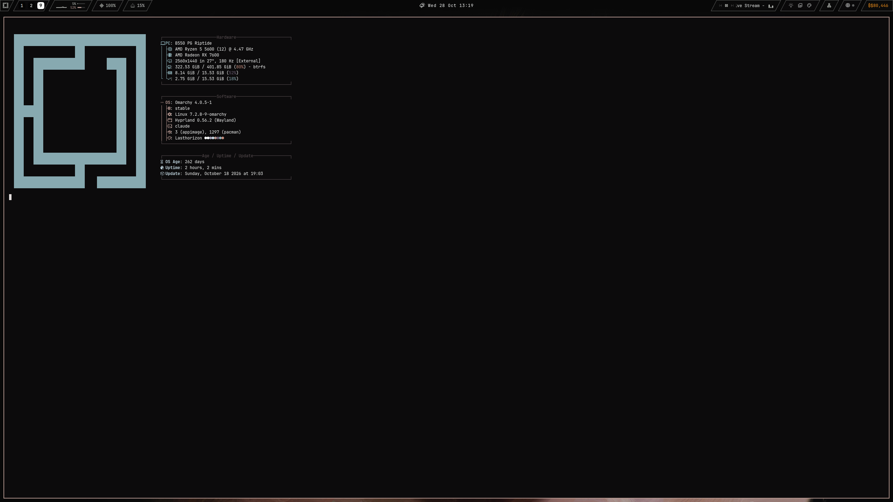

# Dotfiles

Моя рабочая среда / Meu setup diário / My daily setup:

- **OS:** Arch Linux ([Omarchy](https://omarchy.org))
- **WM:** Hyprland (Wayland, config em Lua)
- **Bar:** Quickshell (customizada)
- **Shell:** Zsh + zinit + powerlevel10k · **Terminal:** foot · **Editor:** Neovim (LazyVim)
- **FS:** Btrfs



## Estrutura

| Pasta | Conteúdo |
|---|---|
| `config/` | o que vive em `~/.config` (hypr, nvim, foot, kitty, quickshell, omarchy, mpv, btop, tmux, voxtype, wireplumber…) |
| `bin/` | scripts próprios de `~/.local/bin` |
| `lib/` | shims de `~/.local/lib` (ex.: `voxtype-shim/wtype`, cola via Hyprland em apps XWayland) |
| `systemd/user/` | serviços e timers do usuário (+ drop-ins `*.service.d/`) |
| `zshrc`, `bashrc`, `p10k.zsh` | shell |

## Atualizar

```bash
./sync.sh && git add -A && git commit -m "update" && git push
```

`sync.sh` só **copia** do sistema para o repositório — nunca sobrescreve nada no sistema.
Temas e plugins do Omarchy ficam de fora (são de terceiros e pesados).
